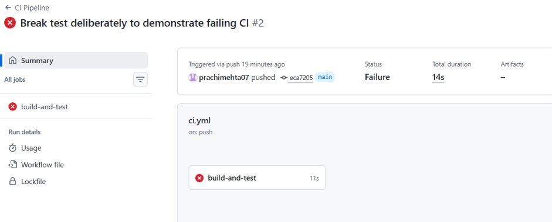
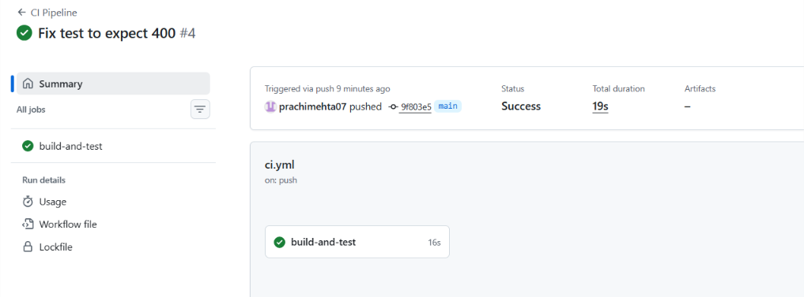

# Task Manager API

A RESTful backend for a task management system, built with Node.js and Express, as part of Advanced Web Development Frameworks (ITUE301) practical coursework.

## Practical 4: RESTful API with Express

### Objective
Design and implement a RESTful backend server with complete CRUD endpoints using an Express middleware pipeline.

### Endpoints
- `GET /tasks` — list all tasks
- `POST /tasks` — create a task
- `PUT /tasks/:id` — update a task
- `DELETE /tasks/:id` — delete a task

### Middleware Pipeline
1. `express.json()` — parses JSON request bodies
2. `logger` — logs method, URL, and timestamp for every request
3. `validateContentType` — rejects POST/PUT requests missing `Content-Type: application/json`
4. `validateTaskId` (route-specific) — validates `:id` is a positive integer before reaching the controller
5. 404 handler — catches undefined routes
6. `errorHandler` — global error handler, always last

### Data
In-memory array (no database yet — MongoDB integration is Practical 5).

### Run Locally
```bash
npm install
node server.js
```
Server runs on `http://localhost:5000`.

### Technologies
- Node.js
- Express
- Postman (testing)


## Practical 5 — MongoDB Integration with Mongoose

- Connected Express server to MongoDB Atlas using Mongoose, via `config/db.js`
- Task schema: `title` (required), `description`, `completed` (default false), `priority` (enum: low/medium/high, default low), `createdAt` (default now)
- Pre-save hook trims whitespace from `title` on document creation
- All CRUD routes now use Mongoose model methods instead of an in-memory array
- Validation errors returned as structured JSON, not raw Mongoose error objects
- `GET /tasks/:id` added with 404 for missing tasks and 400 for malformed ObjectIds
- `.env` holds `MONGO_URI`; `.env.example` provided as a template, `.env` excluded via `.gitignore`

### Run Locally
```bash
npm install
Copy-Item .env.example .env   # PowerShell — then fill in your own MONGO_URI
npm run dev
```

## Practical 6 — CORS for Frontend Integration

- Enabled `cors` middleware to allow requests from the React dev server (`localhost:5173`)
- Connected to and tested against the `portfolio-d25it121` frontend's Tasks page

## Practical 7 — JWT Authentication

- `POST /auth/register` — creates a user, password hashed with bcrypt
- `POST /auth/login` — verifies credentials, returns a JWT (1 hour expiry)
- `GET /auth/me` — returns the logged-in user's details (protected)
- All `/tasks` routes now require `Authorization: Bearer <token>`
- Server-side validation rejects task creation requests missing a title
- `JWT_SECRET` stored in `.env`, never committed

## Practical 9 — In-Memory Caching with node-cache

- `GET /tasks` and `GET /tasks/:id` responses cached per-user (60s TTL)
- Cache key includes the authenticated user's ID to prevent cross-user data leakage
- Cache invalidated on every POST/PUT/DELETE for the affected user
- `GET /tasks/cache/stats` exposes cumulative hit/miss counts
- Known limitation: cache is in-memory and resets on server restart; not suitable for multi-instance deployment

### Response Time Comparison (GET /tasks)

| Reading | Uncached | Cached |
|---|---|---|
| 1 | ___ ms | ___ ms (miss) |
| 2 | ___ ms | ___ ms (hit) |
| 3 | ___ ms | ___ ms (hit) |


## Practical 10 — Event-Driven Notifications

- Created a shared EventEmitter instance in `events/taskEvents.js`.
- Registered task-created, task-deleted, and error listeners in `events/listeners.js`.
- Registered listeners once at startup in `server.js`.
- Emitted task-created after successfully creating a task and sending the API response.
- Emitted task-deleted after successfully deleting a task.
- Simulated a two-second notification delay and compared it with a synchronous delay.
- Tested error forwarding through the error listener.

## Practical 11 — Docker and Docker Compose

- `Dockerfile` for the backend; multi-stage `Dockerfile` (Node build, nginx serve) for the frontend in `portfolio-d25it121/frontend`
- `docker-compose.yml` orchestrates frontend (5173), backend (5000), and MongoDB (27017) on a shared `app-network`
- MongoDB data persists in the named volume `mongo-data`
- `.dockerignore` excludes `node_modules` and `.env`

### Run the full stack
Clone both repos side by side (`task-manager-api-d25it121` and `portfolio-d25it121`), create `.env` from `.env.example` with a `JWT_SECRET`, then:
```bash
docker compose up --build
```
Open http://localhost:5173

## Practical 12 — CI Pipeline with GitHub Actions

- Workflow `.github/workflows/ci.yml` runs on every push to `main`: checkout, setup Node 22, `npm install`, `npm test`
- 3 Jest + Supertest tests that don't need a database: unauthenticated `/tasks` → 401, unknown route → 404, empty login body → 400
- `server.js` exports `app` and only starts listening when run directly, so tests import it without connecting to MongoDB

### Pipeline runs
Failed (deliberately broken test): 
Passed (after fix): 

## Practical 13 — AI Integration (Gemini)

- `POST /ai/subtasks` (JWT-protected) sends only the task title to the Gemini API and returns 3–6 suggested subtasks
- API key and model name live in `.env` (`GEMINI_API_KEY`, `GEMINI_MODEL`); the key is never exposed to the frontend
- 10-second timeout; any failure returns `{ subtasks: [], fallback: true }` so the app keeps working
- Rate limit: one generation per user per title per minute (429 otherwise)
